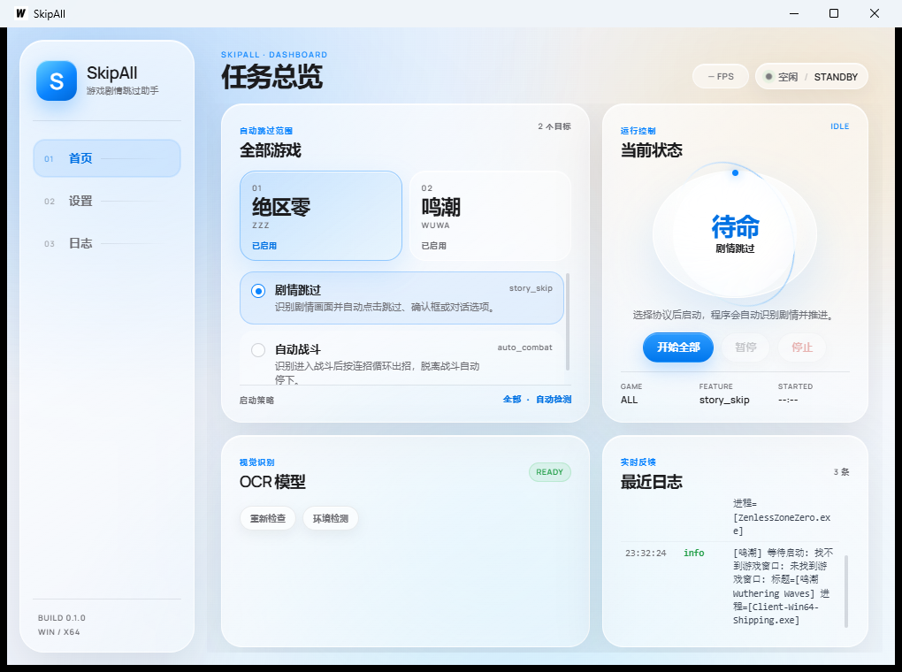

# 自动战斗能力对照表

上游两个参考实现：鸣潮 `ok-wuthering-waves`（AGPL-3.0）、绝区零 `ZenlessZoneZero-OneDragon`（GPL-3.0）。
本文件列出每一项上游能力在本项目的落点、验证方式与已知差异，用来判断"补到什么程度"。

- 共享流程：`pkg/assist/combat`（不含任何游戏数据）
- 鸣潮：`games/wuwa/`
- 绝区零：`games/zzz/`
- 素材：`assets/games/<game>/templates`

## 共享层（两个游戏共用）

| 能力 | 落点 | 说明 |
| --- | --- | --- |
| 战斗判据 | `Spec.DetectAreas` / `HealthBar` / `BossBar` | 模板或颜色矩形，任一命中即视为在战斗 |
| 连招 | `Spec.Plan` + `Spec.PlansByAgent` | 默认连招 + 角色专属连招 |
| 技能就绪 | `Spec.Ready` | 按钮高亮颜色占比 |
| 冷却 | `Spec.Cooldowns` | 按钮区域 OCR 到正数即视为冷却中，500ms 缓存 |
| 切人 | `Spec.Roles` + `Spec.Switch` | 按角色定位打分 + 久未出场加分 + 大招就绪加分 |
| 治疗位 | `Spec.HealerKey` + `HealerLocator` | 能认出治疗位就按它的槽位键 |
| 入场技 | `Spec.IntroSteps` | 切人后插入的一小段 |
| 中断保护 | `Spec.AbortArea` + `AbortTexts` | OCR 到复活/失败文字就停手 |
| 目标锁定 | `Spec.Target` | 中键锁定，仅未锁定时触发 |
| 游戏扩展 | `Spec.Extensions`（`combat.Extension`） | 抢在通用连招之前的能力 |
| 角色识别 | `combat.Team` 接口 | `Current` / `Agent` / `Slots` |

## 鸣潮

| 上游能力 | 本项目 | 状态 |
| --- | --- | --- |
| `is_health_bar()` / `is_boss()` 判据 | `HealthBar` 红条 + `BossBar` 橙色，整帧颜色矩形 | 已移植 |
| 协奏满切人 | `Concerto` 环覆盖率 + 切人打分 | 已移植 |
| 角色识别（键位数字缺失法） | `games/wuwa/team.go`，模板 `char_N_text` | 已移植 |
| 队伍头像认人 | 63 个角色头像模板，白名单缓存 | 已移植 |
| 角色定位（`char_type`） | 57 条，`agent_roles.go` | 已移植 |
| 角色专属连招（`do_perform()`） | 55 个角色，`agent_plans.go` | 近似（出手顺序） |
| 技能可用性 `available()` | `Spec.Ready` 三个按钮 | 已移植 |
| 冷却 `get_cd()` | `Spec.Cooldowns` + OCR | 已移植 |
| 后台角色解放就绪 `update_lib_portrait_icon()` | `Spec.UltReady` + 6 个 `lib_ready_*` 模板 | 已移植 |
| 共鸣回路提示 `is_e_forte_full()` / `is_mouse_forte_full()` | `wuwaForteExt`（E 强化 / 重击） | 已移植 |
| 治疗位 `switch_healer()` | `HealerLocator`，8 个治疗角色模板 | 已移植 |
| 入场技 `handle_intro()` | `Spec.IntroSteps` = 技能 + 普攻 | 近似（无角色条件分支） |
| 切人优先级 `get_switch_priority()` | 定位打分模型 | 近似（无 intro/buff 时间） |
| 空中判据 `flying()` | `FlyingCheck` + `CombatState.Flying`：edge_levitator 模板确认滑翔装置，白色占比 < 0.1 | 已移植 |
| 解放窗口 `still_in_liberation()` | `CombatState.InLiberation`：按角色记录解放时刻，基类 12 秒 / Encore 9.5 / Xiangliyao 25 | 已移植（墙钟近似） |
| 角色条件分支（能量、Forte 层数） | `wuwaRuleExt` + `agent_rules.go`：171 条规则（54 个角色）用 技能/声骸/解放可用、回路满/未满、协奏满、入场中、飞行中、解放中、需要速切、延奏来源 判定 | 部分移植（能量/Forte 层数等内部计时器条件仍未支持） |

## 绝区零

| 上游能力 | 本项目 | 状态 |
| --- | --- | --- |
| `is_normal_attack_btn_available` 判据 | `普通攻击按钮` 区域 + 模板 | 已移植 |
| 角色识别（`avatar_1_*` / `avatar_2_*`） | 71 + 71 套头像模板，前台/后台分别匹配 | 已移植 |
| 代理人定位（`AgentTypeEnum`） | 54 条，`agent_roles.go` | 已移植 |
| 代理人连招 | 54 个代理人，`agent_plans.go`（全部按角色模板汇总推导） | 近似 |
| `state_handler` 条件→动作规则 | 54 个代理人 / 369 条规则，`state_rules.go` + `zzzStateRuleExt` | 已提取，303/369 条条件可完全判定（82%） |
| 整队节奏规则（专属配队） | 41 条，`team_rules.go` | 已提取，26/41 条条件可判定（63%） |
| 能量条识别 | `vision.GrayRunLength` + 上游 `energy_3_N` 模板 | 已移植（量程 0-120 近似） |
| 角色状态检测（`AgentStateDef`） | 17 条颜色判定，按 `AgentStateCheckWay` 分派 | 已移植 |
| 技能可用性（按角色属性判色域） | 按钮亮起近似 | 近似 |
| 冷却 `has_cd` | `Spec.Cooldowns` + OCR | 已移植 |
| 连携技（连携条 + 左右认人） | `zzzChainExt` | 已移植（认人 + 定位优先选边） |
| 快速支援 | `zzzQuickAssistExt`，按点亮槽位换人 | 已移植 |
| 极限闪避与格挡决策（`config/dodge/智能格挡`） | `zzzDodgeExt`：黄光按"支援攻击"定位优先级（击破>命破>防护>异常）切人格挡 + 普攻；红光闪避 + 普攻 | 已移植（颜色近似，上游用 YOLO；"声音"触发不支持） |
| 终结技可用 | `zzzUltimateExt` | 已移植（亮度近似） |
| 失衡窗口 | 规则引擎用"连携条可见"近似 | 近似 |
| 切人事件 | 站场头像变化打时间戳 | 近似（分不出上/下一个） |
| 邦布 | 连携里作为第四个选项，不影响选边 | 说明性 |
| 不可判定的自定义状态 | `自定义-终结技被强制释放` 等 28 条规则条件 | **未支持**（上游也是自定义配置内部变量） |

## 性能口径（实测，i7-13700K / 1920×1080 帧）

用 `go test ./games/zzz -bench BenchmarkAvatar` 量的单张头像模板匹配代价：

| 场景 | 耗时 |
| --- | --- |
| 绝区零：单张头像匹配（170×70 搜索区） | 约 3.2ms |
| 绝区零：71 张全量认人 | 约 226ms |
| 绝区零：白名单 3 张 | 约 10ms |
| 鸣潮：单张角色头像匹配（90×80 搜索区，模板来自 4K 裁剪） | 约 1.6ms |
| 鸣潮：分批认人一帧（1 张 × 3 槽位） | 约 4.8ms |
| 连携条颜色判定 | 0.02ms |

战斗循环按 10 FPS 跑（每帧 100ms 预算），所以：

- 全量认人**必须分摊**——绝区零每帧最多比 8 张（`scanBatch`，约 25ms/帧），鸣潮每帧 1 张（`wuwaScanBatch`，约 4.8ms/帧，63 张约 300ms 扫完一轮）；
- 认出来之后只比白名单（3 张），约 10ms/帧；
- 连携选边、格挡换人复用同一份白名单与槽位识别结果，不再各自重扫头像；
- 槽位识别结果缓存 500ms（一帧里规则引擎、格挡、连携都要问"谁在哪"）；
- 鸣潮槽位搜索区按模板实际几何收紧到 90×80（之前用 150×100 的整条右边栏），单帧从 36ms 降到 4.8ms。
- 白名单失效兜底：前台认不出来（换了个没见过的角色）就作废白名单、从游标继续分批认。

## 已清理：错位的队伍模板

`assets/games/wuwa/templates/team` 原有 65 个模板，其中 6 个（`Augusta_lib1`、`Augusta_lib2`、`hsin_lib1`、`hsin_lib2`、`denia_end_lib`、`lib_cartethyia_big`）的上游记录坐标在 y≈1886–1894（4K），那是**解放界面**的位置，队伍槽位在 y≈464/723/986。它们参与认人只会带来误匹配，已删除；后续补新角色模板，当前 63 个。

代价：hsin、denia 两个角色失去唯一模板，认不出来时退回默认连招（而不是错误地匹配成别人）。

### 每帧预算拆解（绝区零，实测）

10 FPS 下每帧 100ms 预算。绝区零战斗一帧里要做的事：

| 环节 | 实测 | 说明 |
| --- | --- | --- |
| 规则引擎条件求值 | 约 4.5ms | 369 条规则，逐条解析条件字符串（`BenchmarkRuleEngineStep`，不含视觉） |
| 认人（白名单） | 约 10ms | 1-3 张头像模板 × 3 槽位，500ms 缓存 |
| 快速支援模板 | 约 6ms | 2 张模板 |
| 能量条 | 约 2ms | 1 张条状模板 + 灰度扫描 |
| 连携条 / 闪光颜色 | <0.2ms | 纯像素统计 |
| **合计** | **约 22ms** | 留出约 78ms 给截图与输入 |

鸣潮一帧：认人 4.8ms（分批）+ 回路提示 2 张模板，其余为颜色统计，合计约 10ms。

## 已知差异汇总

1. 鸣潮角色连招是 `do_perform()` 的出手顺序近似；逐角色条件规则已机械提取 171 条（54 个角色），但能量/Forte 层数与内部计时器条件仍未支持。
2. 绝区零 81/369 条规则条件依赖本项目无法判定的状态（主要是 `仪玄-术法值`、`雅-落霜` 这类没有颜色定义的专属资源条），不会命中。
3. `zzzDodgeExt` 用颜色占比近似上游的 YOLO 分类，阈值需要实机校准。
4. 所有坐标来自上游 1080p/4K 参考裁剪并按固定像素归一化，未在实机上逐项校色。
5. 未在真机验证：鸣潮目标锁定区域、协奏环阈值、绝区零攻击按钮区域、快速支援区域、治疗位槽位假设。

## 运行验证（打包产物）

用打包出来的 `bin/skip-all.exe` 直接启动核对过（无游戏窗口的情况下）：

- 主界面正常渲染，两个游戏都显示"已启用"，功能列表里 `story_skip` 与 `auto_combat` 都在；
- OCR 模型状态 READY；
- 日志按预期报"找不到游戏窗口"，说明游戏窗口探测在跑；
- 配置落盘在 `%APPDATA%\skip-all\`：`config.yaml`（运行模式、热键、截图 FPS、OCR）与 `games/{zzz,wuwa}.yaml`（各功能开关）。实测两个游戏的 `auto_combat.enabled` 都是 `true`。

注意：这只证明"程序跑起来、功能注册、配置落盘"。**战斗逻辑本身没有在真机上验证过**——需要游戏窗口在跑。
